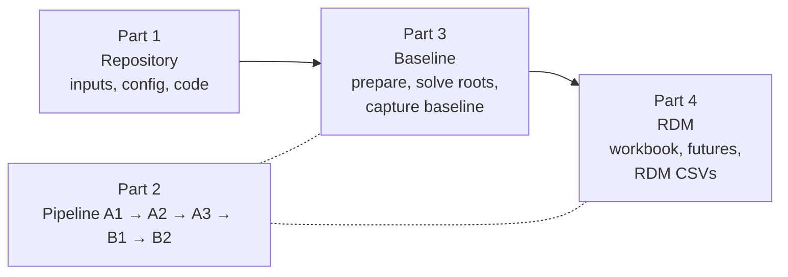
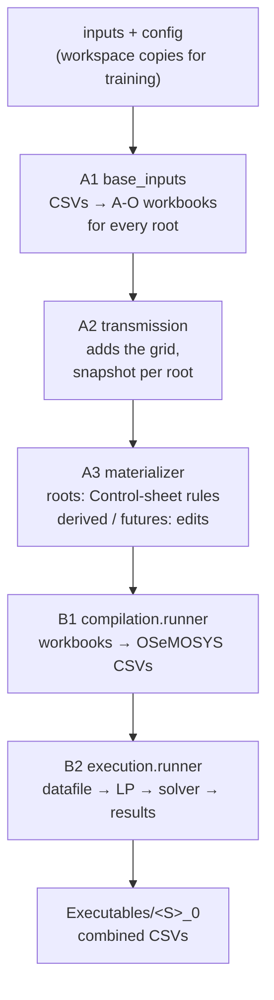

# OSTRAM and RDM: user guide

This guide takes you from a fresh clone to a finished RDM run. It is written
for someone who runs the model, and who also wants to know **which script runs
when, what it reads and what it writes**.

This guide is also a single HTML page, `docs/html/OSTRAM_RDM_User_Guide.html`,
and every page of the documentation is in
`docs/html/OSTRAM_Complete_Documentation.html`. Both are rebuilt from the
Markdown pages with `python tools/build_html_docs.py --bake`.

It has four parts:

1. [The repository](#part-1-the-repository): what each folder holds and which
   stage of the pipeline uses it.
2. [The pipeline](#part-2-the-pipeline): what each command calls, stage by
   stage.
3. [The baseline](#part-3-the-baseline): set up the training model and build,
   solve and check the root scenarios. This is what the training exercises do,
   and it comes first, because every RDM future starts from a root.
4. [RDM](#part-4-rdm-futures): describe futures in one Excel workbook, run them
   all, and collect the RDM CSVs.

The examples use the two-region training model (`unescap_training`:
Bangladesh and India East), which solves in minutes.
[Part 5](#part-5-the-south-asia-model) says what changes for the South Asia
model. The [RDM futures](rdm.md) page is the short reference for the RDM
workbook and commands.



Every command runs from your OSTRAM folder, the root of the clone, in an
Anaconda Prompt, with the environment active (step 3.1).

---

## Part 1. The repository

### 1.1 Top-level folders

Your clone (for example the folder `OSTRAM_PERT`) holds the source: code,
inputs and configuration. Everything the pipeline generates goes into
`workspace\`, which Git ignores.

| Folder or file | What it holds | Used when |
|---|---|---|
| `ostram\` | The Python package: every stage of the pipeline and every command. See 1.2. | Every command. |
| `inputs\` | The **South Asia** model's input data: `osemosys_global\` (64 OSeMOSYS Global CSVs), `preparation\` (country centrepoints, the technology–country matrix, workbook templates), `scenarios\` (the scenario workbook and the timeslice workbook), `execution\` (the gas and oil fallback caps). | A1 reads `osemosys_global\` and `preparation\`; A3 reads `scenarios\`; B2 reads `execution\`. The training setup has its own inputs, except `execution\`, which it shares. |
| `config\` | The **South Asia** configuration: `setups\` (which setups exist; `south_asia.yaml` with the scenario registry and VRE ceilings), `preparation\` (countries and regions), `compilation\` (years, timeslices, workbook names), `execution\` (solver and model-file adjustments), `scenarios\` (each root's rule settings and each derived scenario's `scenario.yaml`). | `config\setups\registry.json` at every command; the rest by A1 to B2 for the South Asia model. |
| `examples\unescap_training\` | The **training setup**: its own `setup.yaml`, `inputs\` and `config\`, laid out like the top-level ones. See 1.3. | Every command with `--setup unescap_training`. |
| `model\osemosys_fast_preprocessed.txt` | The OSeMOSYS model, in GMPL. Shared by both setups. | B2: `glpsol` reads it (a storage-delay copy of it) to write the LP. |
| `docs\` | This documentation. | People; Sphinx builds the website from it. |
| `tests\` | Tests that run without a solver. | `python -m unittest discover -s tests -p "test_*.py"`. |
| `timeslice_module\` | The tool that built the 20-timeslice fabric, with its inputs. | People, by hand. The pipeline does not read it. |
| `tools\` | A script that regenerates the scenario catalogue page. | The tests. |
| `workspace\` | **Everything generated**: built workbooks, compiled CSVs, solver files, results, logs, RDM runs. See 1.4. | Written by every stage. Git ignores it. |
| `environment.yaml` | The conda environment `OSTRAM-env`: Python, pandas, otoole, GLPK, CBC. | `conda env create`, and the environment check at the start of `run`. |
| `pyproject.toml` | The package definition. | `pip install -e .` |
| `dvc.yaml`, `.dvc\` | Data version control. | `run` without `--skip-pull`. `rdm run` always skips it. |
| `README.md`, `AGENTS.md`, `CONTRIBUTING.md` | The front page; rules for AI agents; rules for changes. | People. |

### 1.2 Inside `ostram\`

| Folder or file | Role | Stage |
|---|---|---|
| `__main__.py` | The command line, `python -m ostram <command>`: picks the setup and workspace, then calls the module of the command. | All |
| `paths.py`, `setups.py`, `setup_workspace.py` | Where every file is: project, workspace, the active setup's inputs and configuration. | All |
| `examples.py` | `example prepare` and `example report`. | Setup, results |
| `pipeline\orchestration.py` | `run`: the environment check, DVC, then A1 to B2 in order. | All of `run` |
| `pipeline\preparation\` | `base_inputs.py` (**A1**), `transmission.py` (**A2**), and the country template, merge and validation commands. | A1, A2 |
| `pipeline\scenarios\` | **A3**: `materializer.py` (builds the roots, then the derived scenarios), `transform.py` (a root's stages), `transformations\` (the stage scripts), `rules\` (the rule scripts named in the Control sheet), `scenario_edits.py` (the edits of a derived scenario or RDM future), `registry.py` (the list of scenarios). | A3 |
| `pipeline\compilation\` | **B1**: `runner.py` and `compiler.py` turn workbooks into OSeMOSYS CSVs. | B1 |
| `pipeline\execution\` | **B2**: `runner.py` (CSVs to datafile), `preprocess.py`, `model_file_adjustments\`, `orchestrator.py` (LP, solver, results), the concatenation modules. | B2 |
| `rdm\` | **RDM**: `interface.py` (the workbook), `design.py` (futures and sampling), `collect.py` (the RDM CSVs), `cli.py` (the `rdm` command). | Part 4 |
| `reporting\` | The training dashboard and the summary workbook. | `example report` |
| `resources\` | Package files: the otoole conversion format, empty CSV templates, the Maldives country template. | B2, country commands |

### 1.3 Inside `examples\unescap_training\`

| Path | What it holds | Read by |
|---|---|---|
| `setup.yaml` | The setup: where each input and configuration file is, which ones are copied to the workspace, the setup's policies (for example: no base-year pin), and the exact technologies and fuels the compiled model may hold. | Every command with `--setup unescap_training` |
| `inputs\osemosys_global\` | 64 OSeMOSYS Global CSVs for Bangladesh and India East. | A1 (through the workspace copy) |
| `inputs\scenarios\OSTRAM_Scenario_Inputs.xlsx` | The scenario workbook: the **Control** sheet (each root's rule scripts), costs, existing and planned generation, the interconnector, demand projections, RE targets, restrictions. | A3 (through the workspace copy) |
| `inputs\scenarios\OSTRAM_Timeslice_Inputs.xlsx` | Year splits, demand profiles and capacity factors of the 20 timeslices. | A3 (through the workspace copy) |
| `inputs\preparation\` | `centerpoints.csv`, `secondary_technologies\Tech_Country_Matrix.xlsx`. | A1, country commands |
| `config\preparation\` | `Config_country_codes.yaml` (countries, regions, technology mapping), `Config_region_consolidation.yaml` (switched off). | A1, A2, A3 |
| `config\compilation\Config_MOMF_T1_A.yaml` | Years, timeslices, storage set, workbook names. | A1, A3, B1, B2 |
| `config\execution\Config_MOMF_T1_AB.yaml` | The solver (CBC), its tolerances and time limit, and the model-file adjustments. | B2 |
| `config\scenarios\registry.json` | The roots `BAU`, `A_Calibrated_BAU`, `B_Optimised_VRE`, `C_Target_VRE`, and their dependencies. | Every command |
| `config\scenarios\<root>\*.yaml` | Each root's rule settings: retirement schedule, build cap, interconnector caps, storage floors, VRE targets. | A3, the root's rules |
| `config\scenarios\technology_types.csv`, `ao_extension_decisions.csv` | The technology categories; which new technologies A3 adds to the workbooks. | A3 |

### 1.4 Inside `workspace\` (generated)

For the training model everything is under `workspace\setups\unescap_training\`;
for South Asia, directly under `workspace\`.

| Folder | What it holds | Written by |
|---|---|---|
| `authorities\` | The workspace copies of the training inputs (OSeMOSYS Global CSVs, scenario workbook, timeslice workbook, preparation inputs). Some stages write into these, so the originals stay clean. | `example prepare` |
| `preparation\og_csvs_inputs\`, `preparation\extra_inputs\` | The staged base CSVs; the emissions and storage workbooks. | A1 |
| `preparation\A1_Outputs\_post_a2_snapshot_<root>\` | Each root's model after A2: the starting point of every later build. | A2 |
| `preparation\A1_Outputs\A1_Outputs_<scenario>\` | The A-O workbooks of a root, derived scenario or RDM future (`A-O_Parametrization.xlsx`, `A-O_Demand.xlsx`, `A-O_AR_*.xlsx`), and for derived scenarios and futures the edit log `apply_patches_CHANGES_<time>.json`. | A1, A2, A3 |
| `scenarios\_run_<time>\` | A root's working folder during A3; removed at the end. | A3 |
| `compilation\A2_Output_Params\<scenario>\` | The compiled OSeMOSYS parameter CSVs. | B1 |
| `execution\A2_Outputs_Params_otoole\<scenario>\` | The CSVs normalised for otoole. | B2 |
| `execution\Executables\<scenario>_0\` | The datafiles (the last one, `…_StorageDelayN5_OpenBCK_RMCarefulXLSX.txt`, is what the solver sees), the LP, the solution, the input table `<scenario>_0_Input.csv`, the result table `…_output.csv` and `Outputs\`. | B2 |
| `execution\OSTRAM_StorageDelay_{Inputs,Outputs,Combined_Inputs_Outputs}.csv` | All scenarios in `Executables\` stacked, with dated copies. | B2, at the end of a run |
| `reports\` | The training dashboard `unescap_training.html` and `snapshots\<label>.csv`. | `example report` |
| `rdm\<Run_Name>\` | One RDM run: futures, experiment design, RDM CSVs. | `rdm generate`, `rdm run` |
| `logs\<run-id>\run.log` | The full log of one run: every child command and its output. | `run`, `rdm run` |

### 1.5 Folder names do not match the stage labels

The workspace folder names come from the original model-building scripts
and predate the stage labels A1 to B2. Read them by what they hold, not by
their prefix:

- `preparation\A1_Outputs\` is not only A1's output. It holds the A1 + A2
  snapshots, every scenario and future that A3 builds, and the completed
  workbooks that B1 adds to each scenario's folder.
- `compilation\A2_Output_Params\` is **B1's** output, not A2's.
- `execution\A2_Outputs_Params_otoole\` is **B2's** output, not A2's.

The chain, as folders:

| Stage | Reads | Writes |
|---|---|---|
| A1 + A2 | `inputs\osemosys_global\` (the raw OSeMOSYS Global CSVs) | `preparation\A1_Outputs\_post_a2_snapshot_<root>\` (built once, reused by later runs) |
| A3 | the snapshot, and for futures the run folder's `scenario.yaml` | `preparation\A1_Outputs\A1_Outputs_<scenario>\`: the A-O workbooks and, for derived scenarios and futures, the edit log `apply_patches_CHANGES_<time>.json` inside that folder |
| B1 | `A1_Outputs_<scenario>\` | `compilation\A2_Output_Params\<scenario>\` (OSeMOSYS parameter CSVs); the `*_COMPLETED.xlsx` workbooks in `A1_Outputs_<scenario>\` |
| B2 | `compilation\A2_Output_Params\<scenario>\` | `execution\A2_Outputs_Params_otoole\<scenario>\`, then `execution\Executables\<scenario>_0\` (datafile, LP, solution, results) |
| `rdm run` (collect) | `execution\Executables\<future>_0\` of every future | `rdm\<Run_Name>\RDM_Inputs.csv`, `RDM_Outputs.csv`, `RDM_Run_Status.csv` |

The CSVs in `inputs\osemosys_global\` and in `compilation\A2_Output_Params\`
have the same form (one OSeMOSYS parameter per file) but sit at opposite ends
of the chain: the first are the starting data, the second are one
scenario's finished parameters. B1 never writes into `inputs\`.

---

## Part 2. The pipeline

### 2.1 Commands and what they call

| You type | It calls | Does |
|---|---|---|
| `python -m ostram example prepare unescap_training` | `ostram.examples` → `setup_workspace.prepare_setup` | Creates the training workspace and copies its inputs into `authorities\`. |
| `python -m ostram [--setup S] run --scenarios …` | `ostram.pipeline.orchestration` | The whole pipeline, A1 to B2 (2.2). |
| `… run … --compile-only` | the same | A1 to B2, stopping before the LP and the solver. |
| `python -m ostram [--setup S] transform --scenario R` | `ostram.pipeline.scenarios.transform` | A3 for one root only. |
| `python -m ostram [--setup S] compile-inputs --scenarios …` | `ostram.pipeline.compilation.runner` | B1 only. |
| `python -m ostram example report unescap_training [--capture L]` | `ostram.examples` → `ostram.reporting.training_dashboard` | The dashboard; `--capture` saves the latest results as snapshot `L`. |
| `python -m ostram --setup S country template / merge / validate` | `ostram.pipeline.preparation.country_commands` | Add a country's data (exercise A). |
| `python -m ostram --setup S rdm template / generate / run / collect` | `ostram.rdm.cli` | RDM (Part 4). `rdm run` calls `orchestration` itself. |

### 2.2 The stages of `run`

`run` checks the conda environment, skips DVC with `--skip-pull`, then runs
five stages. Each stage is a separate Python process, started as
`python -B -m <module>`; the full command lines are in the run log.



| Stage | Module | Reads | Writes (under the workspace) | When it runs |
|---|---|---|---|---|
| **A1** Prepare the base model | `ostram.pipeline.preparation.base_inputs` | the OSeMOSYS Global CSVs, `Config_country_codes.yaml`, `Tech_Country_Matrix.xlsx`, the workbook templates, `Config_MOMF_T1_A.yaml` | `preparation\og_csvs_inputs\`, `preparation\extra_inputs\`, `A1_Outputs_<root>\` for all four roots | Only when a needed root has no post-A2 snapshot (the first run in a workspace). |
| **A2** Add the transmission network | `ostram.pipeline.preparation.transmission` | `Config_country_codes.yaml`, the roots' workbooks | the grid-tier and interconnector rows, then `_post_a2_snapshot_<root>\` | Together with A1. |
| **A3** Build the scenarios | `ostram.pipeline.scenarios.materializer` | the registry, the scenario and timeslice workbooks, the roots' rule YAMLs, each derived scenario's or future's `scenario.yaml` | `A1_Outputs_<root>\`, `A1_Outputs_<scenario>\`, `_scenario_materialization.json` | Every run, for the selected scenarios and the roots they need. |
| **B1** Compile | `ostram.pipeline.compilation.runner`, which runs `…compilation.compiler` per scenario | the scenario's four A-O workbooks, `extra_inputs\`, the compilation configuration | `compilation\A2_Output_Params\<scenario>\*.csv` | Every run. |
| **B2** Run and collect | `ostram.pipeline.execution.runner` → `…execution.orchestrator` | the compiled CSVs, `Config_MOMF_T1_AB.yaml`, `model\osemosys_fast_preprocessed.txt`, `firm_capacity_fallbacks_by_cr.xlsx` | `execution\A2_Outputs_Params_otoole\<scenario>\`, `execution\Executables\<scenario>_0\`, the combined CSVs | Every run; `--compile-only` stops it after the datafile. |

### 2.3 Inside A3

**A root** (for example `B_Optimised_VRE`) is rebuilt from its post-A2
snapshot in a working folder `scenarios\_run_<time>\`, through
`ostram.pipeline.scenarios.transform`:

| A3 step | Scripts (in `ostram\pipeline\scenarios\`) | What it does |
|---|---|---|
| Stage 0 | `transformations\scenario_workbooks` | Takes the root's rows of the scenario workbook, merged over the `BAU` rows. |
| Stage 1 | `transformations\merge_timeslices`, `extract_ao_extensions`, `ao_extension_decisions`, `update_ao_from_extensions`, `apply_manual_fixes`, `propagate_timeslice_fabric` | Writes the workbook's values and any new technologies into the A-O workbooks; applies the 20 timeslices. |
| Stage 1b | `insert_reserve_margin`, `add_max_capacity_investment_rule`, `fix_elc_pmode_revert`, `pre_solver_validation` | Reserve margin, investment caps, checks. |
| Stages 2–3 | `add_ao_c2a`, `fix_pwrpet_clear`, `fix_trn_residuals`, `clear_stale_unbinding_caps`, `cap_trn_to_residual` | Unit conversions; interconnector residual capacities and caps. |
| Stage 5, the root's rules | `rules\*.py`, in the order of the **Control** sheet, each reading `config\scenarios\<root>\<rule>.yaml` | For the training roots: `BAU` build cap; `A_Calibrated_BAU` retirement, build cap, minimum capacity floors, interconnectors; `B_Optimised_VRE` retirement, build cap, interconnectors, interconnector direction, storage minimum investment; `C_Target_VRE` retirement, build cap, VRE targets (from the solved `A_Calibrated_BAU`), interconnectors, storage minimum investment. |
| Shared rules | `rules\apply_interconnector_costs`, `apply_internal_transmission`, `apply_internal_tx_losses`, then `apply_base_year_pin` where the setup uses it (South Asia, not training) | Costs and losses of the grid; the reviewed 2023–2026 values. |
| Stage 6 | `transformations\sync_og_to_ts20`, `transform` | Writes the finished A-O workbooks to `A1_Outputs_<root>\`. |

**A derived scenario or an RDM future** does not go through these stages: it
starts from the root's finished `A1_Outputs_<root>\`. `scenario_edits.py`
copies that folder to `A1_Outputs_<scenario>\`, applies the shared VRE
ceilings when switched on, applies the scenario's edits in order, re-applies
the base-year pin where the setup uses one, and writes the edit log.

### 2.4 Inside B2, for one scenario

| B2 step | Module | Writes, in `execution\Executables\<S>_0\` |
|---|---|---|
| Normalise | `execution.runner` | (the CSVs in `execution\A2_Outputs_Params_otoole\<S>\`) |
| Convert to a datafile | otoole | `<S>_0.txt`, and `<S>_0_Input.csv` (the inputs as a table) |
| Preprocess | `execution.preprocess` | `Pre_processed_<S>_0.txt` |
| Storage delay | `model_file_adjustments.storage_delay` | `…_StorageDelayN5.txt` and an adjusted model file |
| Open backstop caps | `model_file_adjustments.open_pwrbck_caps` | `…_OpenBCK.txt` |
| Reserve-margin fallbacks | `model_file_adjustments.reserve_margin_repair_xlsx` | `…_RMCarefulXLSX.txt`: **the datafile the solver sees** |
| *`--compile-only` stops here* | | |
| LP | `glpsol --wlp` | `…_output.lp` |
| Solve | CBC (training) or CPLEX (South Asia) | `…_output.sol`; B2 accepts only an optimal solution |
| Results | otoole and the concatenation | `Outputs\`, `…_output.csv` (the results as a table) |

After the last scenario of the run, B2 stacks every scenario folder in
`Executables\` into `execution\OSTRAM_StorageDelay_*.csv`.

---

## Part 3. The baseline

This part follows the training exercises: set up the training model, then
build and solve its root scenarios. Do it before RDM. Every RDM future starts
from one of these roots, so they must build and solve on your machine first,
and their results are the reference the futures are compared with.

### Step 3.1. Open the prompt

```bat
cd <your OSTRAM folder>
conda activate OSTRAM-env
set PYTHONUTF8=1
```

In PowerShell the last line is `$env:PYTHONUTF8 = '1'`. Repeat this in every
new prompt. Every stage runs under the Python of the active environment, and
`PYTHONUTF8=1` stops Windows from misreading the model files.

### Step 3.2. Be on the RDM branch

The first time:

```bat
git fetch origin
git switch feat/rdm-futures
```

Later, to get new changes: `git pull`. Check with:

```bat
git branch
python -m ostram rdm --help
```

`git branch` puts `*` next to `feat/rdm-futures`, and the help lists
`template`, `generate`, `run` and `collect`. If `rdm` is an unknown command,
the environment runs OSTRAM from another folder: `python -c "import ostram;
print(ostram.__file__)"` shows which; run `pip install -e .` from this clone.

### Step 3.3. Prepare the training model (once)

```bat
python -m ostram example prepare unescap_training
```

**Inside.** `ostram.examples` creates `workspace\setups\unescap_training\` and
copies the training **inputs** into its `authorities\` folder (1.4). The
configuration is not copied: every stage reads it from
`examples\unescap_training\`. When you edit an original input later, the next
command refreshes its copy. No model is built yet. To start again from
scratch, delete `workspace\setups\unescap_training\` and run this step again.

### Step 3.4. Build the roots without solving

```bat
python -m ostram --setup unescap_training run --scenarios "A_Calibrated_BAU,B_Optimised_VRE" --compile-only --skip-pull
```

**Inside**, in order (2.2):

1. **A1 + A2**, the first time only: the base model is built from the
   OSeMOSYS Global CSVs for all four roots, the grid is added, and each root
   gets its snapshot in `preparation\A1_Outputs\_post_a2_snapshot_<root>\`.
2. **A3**: `BAU` is built first, because `A_Calibrated_BAU` inherits its
   restrictions; then `A_Calibrated_BAU` and `B_Optimised_VRE`, each with the
   rule scripts of its Control-sheet row (2.3).
3. **B1**: the two roots are compiled to CSVs.
4. **B2**: the datafiles are written; no LP, no solve.

**Check.** `preparation\A1_Outputs\A1_Outputs_B_Optimised_VRE\A-O_Parametrization.xlsx`
exists, and the console ends with `OSTRAM compile-only run completed successfully`.

### Step 3.5. Solve the roots

```bat
python -m ostram --setup unescap_training run --scenarios "A_Calibrated_BAU,B_Optimised_VRE" --skip-pull
```

A1 and A2 are skipped (the snapshots exist); A3, B1 and B2 run again, and B2
now writes the LP and solves each root with CBC. Then:

```bat
python -m ostram --setup unescap_training run --scenarios "C_Target_VRE" --skip-pull
```

`C_Target_VRE` sets its renewable targets from the solved
`A_Calibrated_BAU`, which the registry finds in
`execution\Executables\A_Calibrated_BAU_0\` of the same workspace. That is why
A is solved first.

**Check.** Each root has an `…_output.csv` in its
`execution\Executables\<root>_0\` folder, and the log shows
`CBC solution status: Optimal`.

### Step 3.6. Capture the baseline and look at it

```bat
python -m ostram example report unescap_training --capture baseline
python -m ostram example report unescap_training
```

The first command copies the latest combined results
(`execution\OSTRAM_StorageDelay_Combined_Inputs_Outputs.csv`) to
`reports\snapshots\baseline.csv`, and both write the dashboard
`reports\unescap_training.html`. Open it in a browser. Later snapshots (with
another `--capture` label) can be compared with this baseline.

### Step 3.7. Changing the model's structure (exercises A and B)

A new country or a new interconnector changes the **structure** of the model:
new technologies, fuels and regions. That belongs in the baseline, not in RDM,
because it reaches stages A1 and A2 and configuration files that every
scenario shares. The training exercises do it like this:

| Exercise | What changes | Where | Picked up by |
|---|---|---|---|
| A: add a country | The country's data, generated with `country template`, merged into the OSeMOSYS Global inputs with `country merge`, checked with `country validate` | the workspace copy of the inputs | A1 |
| | The country in `country_data` and `countries` | `config\preparation\Config_country_codes.yaml` | A1, A2 |
| | Its technologies and its firm-capacity row | `technology_types.csv`, `firm_capacity_fallbacks_by_cr.xlsx` | A3, B2 |
| B: add an interconnector | Rows in `Interconnector_Params` and `Fixed_Horizon_Parameters` | the workspace copy of the scenario workbook | A3, stage 1 |
| | The technology as an interconnector, and its extension decision | `technology_types.csv`, `ao_extension_decisions.csv` | A3 |
| | Its investment caps per root | `config\scenarios\<root>\relax_interconnectors.yaml` | A3, the root's rules |

After such a change, rebuild the baseline from step 3.4; when A1 or A2 inputs
changed, delete the workspace and start from step 3.3. The exercise pages use
an older version's names (`--profile unescap`, `examples\unescap\`); with this
code they are `--setup unescap_training` and `examples\unescap_training\`. The
training setup also lists the exact technologies and fuels its compiled model
may hold (`domain_contract` in `setup.yaml`), so new ones must be added there
too.

Once the structure is in the baseline, RDM can vary it: for example, futures
with and without the new interconnector, or with its cost and capacity
sampled (Part 4).

---

## Part 4. RDM futures

With the baseline in place, RDM runs the same model across many futures.
**A future is the root plus a list of changes.** You describe the futures in
one Excel workbook; `rdm run` builds each one as a derived scenario of the
root (2.3), runs the normal pipeline on all of them, and collects one input
CSV and one output CSV.

| Step | You type | OSTRAM does |
|---|---|---|
| 4.1 | `rdm template` | Writes the Excel interface |
| 4.2 | (fill the workbook) | – |
| 4.3 | `rdm generate` | Checks the workbook, creates the futures, writes the run folder |
| 4.4 | `rdm run` | Builds, compiles and solves every future, then collects the CSVs |
| 4.5 | (open the results) | – |
| 4.6 | change, run again | – |

### Step 4.1. Get the interface workbook

```bat
python -m ostram --setup unescap_training rdm template --out Interface_OSTRAM_RDM.xlsx
```

This only writes an Excel file, `Interface_OSTRAM_RDM.xlsx`, in your OSTRAM
folder. `rdm template` reads the technology and fuel names of the root
`B_Optimised_VRE` from `A1_Outputs_B_Optimised_VRE\` (built in step 3.4) to
fill the Selector dropdown.

**Where the workbook lives.** Keep it in your OSTRAM folder, where you run the
commands. Each run reads it from there and copies it into its run folder as a
record:

| | Where | Written by |
|---|---|---|
| Your workbook, the one you edit | `<your OSTRAM folder>\Interface_OSTRAM_RDM.xlsx` | you, or `rdm template` |
| The run's copy | `workspace\setups\unescap_training\rdm\<Run_Name>\interface.xlsx` | `rdm generate` and `rdm run` |

Always edit your workbook, not the copy. The file name is not the run name:
the run name is `Run_Name` on the Setup sheet (step 4.2).

The template has six sheets (README, Setup, Futures, Future_Changes,
Uncertainty_Table, Outputs) and a hidden `Lists` sheet for the dropdowns.
Futures, Future_Changes and Uncertainty_Table come pre-filled with the worked
example of step 4.2, from row 2; overwrite or delete it. `--blank` leaves it
out.

### Step 4.2. Fill the workbook

**Setup**

| Setting | Example | What it decides |
|---|---|---|
| `Run_Name` | `test01` | The run folder `rdm\test01\` |
| `Base_Scenario` | `B_Optimised_VRE` | The root every future starts from |
| `Samples_Per_Future` | `1` | Sampled variants per named future; 0 means no sampling |
| `Random_Seed` | `12345` | Same seed, same sampled values |
| `Run_Central_Future` | `Y` | Also run each named future without sampled values |
| `Apply_VRE_Ceilings` | `Auto` | The shared solar and wind ceilings; the training setup has none |
| `Model_First_Year`, `Model_Last_Year` | `2023`, `2050` | Where a change with an open end starts or stops |

**Futures**

| Future_ID | Name | Run |
|---|---|---|
| F00 | Baseline | Y |
| F01 | Cheap solar | Y |
| F02 | High demand, dear coal | Y |

A future with no changes is the root itself: **F00 is the baseline future**,
the root solved again inside the RDM run, so its results sit in the same CSVs
as the other futures.

**Future_Changes: what makes each future different**

| Future_ID | Sheet | Parameter | Selector_Type | Selector | Operation | Value | Year_From | Year_To |
|---|---|---|---|---|---|---|---|---|
| F01 | Secondary Techs | CapitalCost | Tech_Prefix | PWRSPV | Multiply_Ramp | 0.7 | 2026 | 2035 |
| F02 | Demand_Projection | SpecifiedAnnualDemand | Fuel_Prefix | ELC | Multiply | 1.15 | 2027 | |
| F02 | VariableCost | VariableCost | Tech | MINCOABGD | Multiply | 2 | | |

In words: in F01 the capital cost of every solar plant (`PWRSPV…`) falls from
100 % in 2026 to 70 % in 2035 and stays there; in F02 electricity demand is
15 % higher from 2027, and Bangladesh's coal price doubles.

`Sheet`, `Selector` and `Parameter` point to cells in the root's model
workbooks in `preparation\A1_Outputs\A1_Outputs_B_Optimised_VRE\`:

| Workbook | Sheet | Holds |
|---|---|---|
| `A-O_Parametrization.xlsx` | Secondary Techs | power plants, storage, interconnectors (`PWR…`, `TRN…`) |
| | Primary Techs | fuel supply (`MIN…`) |
| | Demand Techs | the grid tiers between plants and demand |
| | VariableCost | fuel prices and other running costs |
| `A-O_Demand.xlsx` | Demand_Projection | electricity demand, one row per demand fuel |

A change applies to the rows whose **Tech** column (on Demand_Projection:
**Fuel/Tech**) matches the Selector and whose **Parameter** column matches
Parameter, in the year columns given. Open these workbooks to find the names
to type. They are not the input file `OSTRAM_Scenario_Inputs.xlsx`, whose
sheets have similar names with underscores; RDM never changes that file.

Operations: `Multiply`, `Multiply_Ramp` (a straight line from 1 at
Year_From to Value at Year_To, held after), `Set`, and `Copy_From_Tech` (copy
every year from the technology named in Value). Blank years mean every year.

**Uncertainty_Table: what is sampled inside every future**

| X_Num | X_Category | Involved_Scenarios | Sheet | Exact_Parameters_Involved_in_Osemosys | Selector_Type | Involved_First_Sets_in_Osemosys | X_Mathematical_Type | Min_Value | Max_Value | Initial_Year_of_Uncertainty | Final_Year_of_Uncertainty |
|---|---|---|---|---|---|---|---|---|---|---|---|
| X1 | Demand growth | ALL | Demand_Projection | SpecifiedAnnualDemand | Fuel_Prefix | ELC | Multiply_Ramp | 0.9 | 1.1 | 2026 | 2050 |
| X2 | Gas price | ALL | VariableCost | VariableCost | Tech_Prefix | MINGAS | Multiply | 0.8 | 1.5 | | |

The column names follow the OSeMOSYS RDM interface (`Interface_RDM.xlsx`)
where a column means the same thing; `Sheet`, `Selector_Type` and `Linked_To`
are OSTRAM's own. They play the parts of `Parameter`, `Selector`, `Method`,
`Min`, `Max`, `Year_From` and `Year_To` in Future_Changes. Workbooks written
before, with the short names `X_ID`, `Name`, `Applies_To` and so on, still
read.

Each sample draws one value of X1 and one of X2. `Involved_Scenarios = ALL`
layers them inside every future; `F01, F02` (or `F01 ; F02`) limits them to
those two. `X_Num` may be a number: `1` is the uncertainty `X1`. `Linked_To`
makes one row move with another. These columns do not carry over the rest of
the OSeMOSYS RDM engine: `X_Mathematical_Type` takes `Multiply`,
`Multiply_Ramp` or `Set`, and there is no `Dependency` column.

**Outputs.** The sheet lists every input parameter and result variable of
the model (all 53 parameters and 47 results of the otoole conversion file),
with the sets each is indexed by in `Indexed_By`. `Export = Y` puts it in the
RDM CSVs. Filter `Indexed_By` on `FUEL` or `EMISSION` to find, for example,
`InputActivityRatio` or `AnnualEmissionLimit`. The timeslice-level ones are
large and N by default. A misspelt name, or an input listed as an output, is
reported when the workbook is read. A ticked variable that the model leaves
empty (OSTRAM gives `AccumulatedAnnualDemand` no values: demand is
`SpecifiedAnnualDemand`) has no column in the CSVs; `rdm run` and
`rdm collect` name it.

Save the workbook and close Excel: OSTRAM reads the saved file.

### Step 4.3. Preview the futures

```bat
python -m ostram --setup unescap_training rdm generate --interface Interface_OSTRAM_RDM.xlsx
```

```text
Run folder: ...\workspace\setups\unescap_training\rdm\test01
6 future(s) from 3 named future(s), base scenario B_Optimised_VRE: F00, F00_s001, F01, F01_s001, F02, F02_s001
```

**Inside** (`ostram.rdm.cli` → `interface.py` and `design.py`), in order:

1. **The workbook is checked**: every sheet, every row, all problems listed at
   once with sheet and row. Whether a technology really exists is checked
   later, in A3.
2. **The setup is checked**: `Base_Scenario` must be a root of the setup.
3. **The futures are listed**: with one sample and `Run_Central_Future = Y`,
   each named future becomes itself plus one sample.

   | Future | Starts from | Then applies |
   |---|---|---|
   | F00 | B_Optimised_VRE | nothing |
   | F00_s001 | B_Optimised_VRE | sample 1 of X1 and X2 |
   | F01 | B_Optimised_VRE | the solar ramp |
   | F01_s001 | B_Optimised_VRE | the solar ramp, then sample 1 |
   | F02 | B_Optimised_VRE | the demand and coal changes |
   | F02_s001 | B_Optimised_VRE | the demand and coal changes, then sample 1 |

4. **The values are sampled** by Latin Hypercube from the seed: each range is
   cut into N slices and each slice used once. Sample 1 is the same draw in
   every future, so F01_s001 and F02_s001 differ only by their own changes.
5. **Each row becomes scenario edits**, in the format of a derived scenario's
   `scenario.yaml` (see [scenario edits](scenario-edits.md)). F02's demand row:

   ```yaml
   - sheet: Demand_Projection
     param: SpecifiedAnnualDemand
     fuel_prefix: ELC
     note: 'ASSUMPTION: example, demand 15% above the root from 2027 [Future_Changes row 3]'
     op: multiply
     factor: 1.15
     years: [2027, 2028, ..., 2050]
   ```

   Edits apply in order, so a sample acts on the future's path: F02's ×1.15
   times a demand sample of 0.95 is 1.0925 × the root.
6. **The run folder is written**, `rdm\test01\`:

   | File | Content |
   |---|---|
   | `scenarios\<future>\scenario.yaml` | The edits of each future; each note names its workbook row |
   | `RDM_Experiment_Design.csv` | One row per future: named future, sample number, the value of each X |
   | `futures.yaml` | The list of futures that step 4.4 registers |
   | `rdm_manifest.json` | The settings and the variables to export |
   | `interface.xlsx` | A copy of your workbook |

| Message | Fix |
|---|---|
| `interface workbook not found` | Run from the workbook's folder, or give its full path in quotes |
| `Uncertainty_Table has rows but Samples_Per_Future is 0` | Set `Samples_Per_Future` to 1 or more |
| `Base_Scenario ... is not a root of this setup` | Use a root from the message; check `--setup` |
| `future name(s) ... are already registered scenarios` | Use other Future_IDs |
| `run folder exists` | Change `Run_Name`, or add `--overwrite` |

### Step 4.4. Run everything

```bat
python -m ostram --setup unescap_training rdm run --interface Interface_OSTRAM_RDM.xlsx --overwrite
```

`--overwrite` replaces the run folder of step 4.3. `--compile-only` builds and
compiles without solving. `--env-name <name>` if your environment is not
`OSTRAM-env`.

```text
Run folder: ...
6 future(s) from 3 named future(s), base scenario B_Optimised_VRE: ...
Using environment: OSTRAM-env
[1/5 · A1] Preparing the base model | SKIPPED | required post-A2 root snapshots already exist
[2/5 · A2] Adding the transmission network | SKIPPED | required post-A2 root snapshots already exist
[3/5 · A3] Building selected scenarios | COMPLETED | ...
[4/5 · B1] Compiling model inputs | COMPLETED | ...
[5/5 · B2] Running the model and collecting results | COMPLETED | ...
OSTRAM run completed successfully
Solved: 6, compiled only: 0, missing: 0
```

**Inside** (`ostram.rdm.cli`), in order:

1. **Step 4.3 again**: the saved workbook is read, the run folder rewritten.
2. **Old results are cleared** (`collect.clear_future_folders`): each
   future's `execution\Executables\<future>_0\` from an earlier run is
   deleted, so a future that fails now cannot show old results.
3. **The normal pipeline runs** (`ostram.pipeline.orchestration`, as
   `run --skip-pull --scenarios F00,F00_s001,…`). `rdm run` first sets the
   environment variable `OSTRAM_RDM_FUTURES` to the run's `futures.yaml`;
   while it is set, the scenario registry (`registry.load_futures`) adds each
   future as a derived scenario of the root, with its `scenario.yaml` read
   from the run folder. Nothing in `config\` or `inputs\` changes. Then, per
   Part 2:

   | Stage | For the futures | Where to look |
   |---|---|---|
   | A1 + A2 | Skipped: the root's snapshot exists from Part 3 | `_post_a2_snapshot_B_Optimised_VRE\` |
   | A3, root | `B_Optimised_VRE` rebuilt with its rules (2.3) | `A1_Outputs_B_Optimised_VRE\` |
   | A3, futures | `scenario_edits.build_scenario` per future: copy the root's workbooks, apply the edits (technology edits to `A-O_Parametrization.xlsx`, demand edits to `A-O_Demand.xlsx`), write the edit log | `A1_Outputs_F02\`, `apply_patches_CHANGES_<time>.json` |
   | B1 | Each future compiled | `compilation\A2_Output_Params\F02\` |
   | B2 | Datafile, LP, solve, results per future (2.4). A future uses its root's solver settings (CBC tolerance 1e-9 for `B_Optimised_VRE`) and CBC's primal simplex, which solves these models reliably. A future that fails is recorded and B2 goes on to the next. | `execution\Executables\F02_0\` |

   The edit log lists every changed cell with its old and new value: the
   place to confirm a change did what you meant.
4. **The RDM CSVs are collected** (`collect.collect_run`): for each future,
   its input and result tables are read, the variables with `Export = Y`
   kept, `Future_ID`, `Named_Future` and `Sample` added in front, and the rows
   appended to `RDM_Inputs.csv` and `RDM_Outputs.csv`, one future at a time.
   `RDM_Run_Status.csv` records each future as `solved`, `compiled` or
   `missing`.

**How long.** A3 and B1 take a minute or two for six futures; each solve
takes about one to three minutes, so the six-future example runs in about
15–20 minutes.

| What you see | Meaning and fix |
|---|---|
| `[3/5 · A3] Building selected scenarios \| FAILED`, and in the run log `Scenario F02: the edit to ... changed nothing. ... Did you mean ...?` | A Selector, Parameter or year is not in the root. The console shows only the failed stage; open the run log it names for the message. Fix the workbook row named in the note of `scenarios\F02\scenario.yaml`. An A3 error stops every future of the run. |
| `[FAILED] F01: CBC did not produce an optimal solution` in the log; F01 `compiled` in the status file | F01's solve did not reach an optimum; the other futures still ran. Search the log for `F01`. |
| A failed future took hours | CBC stops at `iteration_time` (20000 s) in `examples\unescap_training\config\execution\Config_MOMF_T1_AB.yaml`. Lower it in your local copy to fail faster; do not commit that. |
| `.lp`, `.sol` or `_output.csv` missing | The run was `--compile-only`, or the future failed; see the status file and the log. |

### Step 4.5. Look at the results

Everything is in `workspace\setups\unescap_training\rdm\test01\`:

1. **`RDM_Run_Status.csv`**: did every future solve?
2. **`RDM_Experiment_Design.csv`**: which future is which, with the sampled
   values: the "X" of scenario discovery.
3. **`RDM_Outputs.csv`**: the results ("M"), one block per future.
4. **`RDM_Inputs.csv`**: the input values each future used.

They share the column `Future_ID`:

```python
import pandas as pd

run = r"workspace\setups\unescap_training\rdm\test01"
design = pd.read_csv(rf"{run}\RDM_Experiment_Design.csv")
outputs = pd.read_csv(rf"{run}\RDM_Outputs.csv", low_memory=False)

cost = outputs.groupby("Future_ID")["TotalDiscountedCost"].sum().rename("cost")
print(design.merge(cost, on="Future_ID"))
```

For the worked example this prints about 566 800 (F00), 566 200 (F01,
cheaper solar) and 658 600 (F02, higher demand and dearer coal). F00 matches
the `B_Optimised_VRE` solved in step 3.5 when the setup applies no ceilings,
as in training.

Compare futures with these reported costs, not with the `objective value` that
CBC prints in the log. B2 reconciles the reported `TotalDiscountedCost` with
the compiled costs (the record is
`execution\Executables\<future>_0\*_cost_reconciliation.json`), so the two
numbers differ: for F00 the log shows 540 166 and the CSV 566 798.

### Step 4.6. Change something and run again

| You want to | Do |
|---|---|
| Keep the old run, start a new one | Change `Run_Name`, save, run step 4.4 without `--overwrite` |
| Replace the old run | Keep `Run_Name`, run step 4.4 with `--overwrite` |
| Export other variables without solving again | Edit the Outputs sheet, `rdm generate … --overwrite`, then `python -m ostram --setup unescap_training rdm collect --run test01` |
| Rebuild the CSVs after a run stopped part way | `python -m ostram --setup unescap_training rdm collect --run test01` |
| Repeat an old run exactly | Use the `interface.xlsx` of its run folder as `--interface` |

Changing `Random_Seed`, or adding, removing or reordering uncertainty rows,
changes every sampled value.

---

## Part 5. The South Asia model

The same parts, with these differences:

- Leave out `--setup unescap_training`: South Asia is the default. Its files
  are directly under `workspace\` (for example `workspace\rdm\<Run_Name>\`),
  its inputs and configuration are the top-level `inputs\` and `config\`, and
  step 3.3 is not needed.
- The baseline is the root scenarios plus the 17 decision scenarios; the
  [pipeline page](pipeline.md#17-scenario-portfolio) gives the order (solve
  `A_Calibrated_BAU` first, then the rest with `--a-result-seed`).
- `Apply_VRE_Ceilings = Auto` applies the shared solar and wind ceilings to
  every future, so F00 differs from the root by those ceilings.
- The base-year pin keeps the reviewed 2023–2026 values of the calibrated
  technologies, even after a `Set` without years.
- B2 solves with CPLEX by default; the model is larger, so run
  `--compile-only` first.
- A future built on `C_Target_VRE` needs a solved `A_Calibrated_BAU`, passed
  with `--a-result-seed <folder>`.

---

## Reference

### What a future cannot do

- Start from another derived scenario: a future starts from a root. Copy
  that scenario's changes into the future's rows.
- Change the model's structure (a new country, technology or interconnector):
  that goes into the baseline (step 3.7).
- Hold a gross import cap or an interconnector direction overlay.
- Change `CapacityFactor`: an edit changes the first row of a technology and
  parameter, and that parameter has one row per timeslice.

### How a workbook row becomes edits

| Row | Edit(s) in `scenario.yaml` |
|---|---|
| `Multiply`, no years | `op: multiply`, `factor` |
| `Multiply` with years | `op: multiply`, `factor`, `years` |
| `Set`, no years | `op: set_flat`, `value` (every year, base years included) |
| `Set` with years | `values: {year: value}` |
| `Copy_From_Tech` | `op: copy_from_tech`, `source_tech` |
| `Multiply_Ramp`, years *a* to *b*, final factor *f* | for each year *y* after *a* up to *b*: `multiply` by `1 + (f − 1)(y − a)/(b − a)`; then `multiply` by *f* for the years after *b* |

### RDM code map

| Module | Role | Step |
|---|---|---|
| `ostram/rdm/interface.py` | Writes the template; reads and checks a workbook | 4.1, 4.3 |
| `ostram/rdm/design.py` | Lists the futures, samples, writes the edits and the run folder | 4.3 |
| `ostram/rdm/collect.py` | Clears old result folders; collects the RDM CSVs | 4.4 |
| `ostram/rdm/cli.py` | The `template`, `generate`, `run` and `collect` commands | 4.1–4.6 |
| `ostram/pipeline/scenarios/registry.py` | Registers the futures while `OSTRAM_RDM_FUTURES` is set | 4.4 |
| `ostram/pipeline/scenarios/scenario_edits.py` | Applies the edits, including demand edits | 4.4, A3 |
| `ostram/pipeline/execution/orchestrator.py` | Root's solver settings and primal simplex for futures; keeps going past a failed future | 4.4, B2 |
| `tests/regression/test_rdm.py` | Tests of all of the above, without a solver | – |
