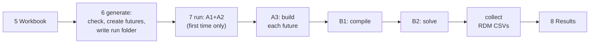

# RDM step by step

This page takes you from a fresh clone to a finished RDM run, one step at a
time. Each step says **what to type**, **what happens inside** OSTRAM, **where
to look** and **what can go wrong**. It uses the two-region training model
(`unescap_training`), which runs in minutes; step 10 says what changes for the
South Asia model.

The [RDM futures](rdm.md) page is the short reference for the workbook and the
commands.

## The steps

| Step | You type | OSTRAM does |
|---|---|---|
| 1 | `conda activate`, `set PYTHONUTF8=1` | – |
| 2 | `git switch` / `git pull` | – |
| 3 | `example prepare unescap_training` | Sets up the training workspace |
| 4 | `rdm template` (or copy a workbook) | Writes the Excel interface |
| 5 | (fill the workbook in Excel) | – |
| 6 | `rdm generate` | Checks the workbook, creates the futures, writes the run folder |
| 7 | `rdm run` | Builds, compiles and solves every future, then collects the CSVs |
| 8 | (open the results) | – |
| 9 | change the workbook, run again | – |
| 10 | the same, without `--setup` | The South Asia model |



Every command runs from your OSTRAM folder (the clone) in an Anaconda Prompt.

---

## Step 1. Open the prompt

**Type**

```bat
cd <your OSTRAM folder>
conda activate OSTRAM-env
set PYTHONUTF8=1
```

In PowerShell the last line is `$env:PYTHONUTF8 = '1'`. Repeat this step in
every new prompt.

**Why.** Every OSTRAM stage runs under the Python of the active environment.
`PYTHONUTF8=1` stops Windows from misreading the model files.

---

## Step 2. Be on the RDM branch

**Type**, the first time:

```bat
git fetch origin
git switch feat/rdm-futures
```

and later, to get new changes:

```bat
git pull
```

**Check**

```bat
git branch
python -m ostram rdm --help
```

`git branch` puts `*` next to `feat/rdm-futures`. The help lists the four
subcommands `template`, `generate`, `run` and `collect`.

**If it goes wrong.** `rdm` is an unknown command when the environment runs
OSTRAM from another folder. `python -c "import ostram; print(ostram.__file__)"`
shows which folder; run `pip install -e .` from this clone to switch it.

`git switch main` takes you back to the original code at any time.

---

## Step 3. Prepare the training model (once)

**Type**

```bat
python -m ostram example prepare unescap_training
```

**What happens inside.** OSTRAM copies the training setup's inputs and
configuration (from `examples\unescap_training\`) into its own workspace,
`workspace\setups\unescap_training\`. No model is built yet: that happens in
step 7, the first time a future needs it.

**Where to look.** `workspace\setups\unescap_training\` now exists. Everything
the training runs write goes under it, and Git ignores the whole `workspace\`
folder.

---

## Step 4. Get the interface workbook

**Type**, to write a new one:

```bat
python -m ostram --setup unescap_training rdm template --out Interface_OSTRAM_RDM.xlsx
```

or copy a workbook you already have into your OSTRAM folder.

**What happens inside.** The template has six visible sheets (README, Setup,
Futures, Future_Changes, Uncertainty_Table, Outputs) with a worked example, and
a hidden `Lists` sheet with the dropdown values. To fill the Selector dropdown,
it reads the technology and fuel names of the root scenario from
`workspace\setups\unescap_training\preparation\A1_Outputs\A1_Outputs_B_Optimised_VRE\`.

**If it goes wrong.** On a fresh workspace the root is not built yet, so the
command says the selector dropdown is empty. The workbook still works: type the
names, or write the template again after step 7 has run once. `--blank` leaves
out the worked example.

The command looks for files relative to the folder you are in, so keep the
workbook in your OSTRAM folder or give its full path in quotes.

---

## Step 5. Fill the workbook

Open the workbook in Excel. This is the worked example of the template, sheet
by sheet.

### Setup

| Setting | Example | What it decides |
|---|---|---|
| `Run_Name` | `test01` | The run folder, `workspace\setups\unescap_training\rdm\test01\` |
| `Base_Scenario` | `B_Optimised_VRE` | The root every future starts from |
| `Samples_Per_Future` | `1` | How many sampled variants each named future gets. 0 means no sampling. |
| `Random_Seed` | `12345` | Same seed, same sampled values |
| `Run_Central_Future` | `Y` | Also run each named future without its sampled values |
| `Apply_VRE_Ceilings` | `Auto` | The shared solar and wind ceilings. Auto uses them when the setup has them; the training setup does not. |
| `Model_First_Year`, `Model_Last_Year` | `2023`, `2050` | The years a change with an open end runs to |

### Futures

| Future_ID | Name | Run |
|---|---|---|
| F00 | Baseline | Y |
| F01 | Cheap solar | Y |
| F02 | High demand, dear coal | Y |

A future with no rows on Future_Changes is the root itself: here F00 is the
baseline. `Run = N` keeps a future in the workbook without running it.

### Future_Changes: what makes each future different

| Future_ID | Sheet | Parameter | Selector_Type | Selector | Operation | Value | Year_From | Year_To |
|---|---|---|---|---|---|---|---|---|
| F01 | Secondary Techs | CapitalCost | Tech_Prefix | PWRSPV | Multiply_Ramp | 0.7 | 2026 | 2035 |
| F02 | Demand_Projection | SpecifiedAnnualDemand | Fuel_Prefix | ELC | Multiply | 1.15 | 2027 | |
| F02 | VariableCost | VariableCost | Tech | MINCOABGD | Multiply | 2 | | |

In words:

- **F01**: the capital cost of every solar plant (every technology whose name
  starts with `PWRSPV`) falls in a straight line from 100 % in 2026 to 70 % in
  2035, and stays at 70 % to 2050.
- **F02**: demand for every electricity demand fuel (names starting `ELC`) is
  15 % higher from 2027 to 2050; and the price of coal in Bangladesh
  (`MINCOABGD`) doubles in every year.

`Sheet` says which part of the model holds the number:

| Sheet | Holds |
|---|---|
| Secondary Techs | power plants, storage, interconnectors (`PWR…`, `TRN…`) |
| Primary Techs | fuel supply (`MIN…`) |
| Demand Techs | the grid tiers between plants and demand |
| VariableCost | fuel prices and other running costs |
| Demand_Projection | electricity demand, one row per demand fuel |

The operations are `Multiply`, `Multiply_Ramp`, `Set` and `Copy_From_Tech`
(copy every year from the technology named in Value). Blank years mean every
year; one year given means from it to the end, or from the start to it.

### Uncertainty_Table: what is sampled inside every future

| X_ID | Name | Applies_To | Sheet | Parameter | Selector_Type | Selector | Method | Min | Max | Year_From | Year_To |
|---|---|---|---|---|---|---|---|---|---|---|---|
| X1 | Demand growth | ALL | Demand_Projection | SpecifiedAnnualDemand | Fuel_Prefix | ELC | Multiply_Ramp | 0.9 | 1.1 | 2026 | 2050 |
| X2 | Gas price | ALL | VariableCost | VariableCost | Tech_Prefix | MINGAS | Multiply | 0.8 | 1.5 | | |

Each sample draws one value of X1 between 0.9 and 1.1 and one of X2 between
0.8 and 1.5. `Applies_To` = ALL layers them inside every future;
`F01, F02` would limit them to those two. `Linked_To` makes one row move with
another.

### Outputs

`Export = Y` puts an input parameter or a result variable in the RDM CSVs.
The timeslice-level variables (for example `RateOfActivity`) are large and are
N by default.

**Then save the workbook and close Excel.** OSTRAM reads the saved file, so
unsaved changes are not seen.

---

## Step 6. Preview the futures (nothing is solved)

**Type**

```bat
python -m ostram --setup unescap_training rdm generate --interface Interface_OSTRAM_RDM.xlsx
```

**You see**

```text
Run folder: ...\workspace\setups\unescap_training\rdm\test01
6 future(s) from 3 named future(s), base scenario B_Optimised_VRE: F00, F00_s001, F01, F01_s001, F02, F02_s001
```

**What happens inside**, in this order.

**6.1 The workbook is read and checked.** Every sheet is checked before
anything is written, and all problems are listed together, each with its sheet
and row: names, numbers, years inside the model years, a selector type that
fits the sheet, an X_ID named by `Linked_To` that exists, and so on. Whether a
technology or fuel really exists in the model is checked later, in step 7.3.

**6.2 The setup is checked.** `Base_Scenario` must be a root of the setup
(`BAU`, `A_Calibrated_BAU`, `B_Optimised_VRE` or `C_Target_VRE`), and
`Apply_VRE_Ceilings` is turned into Y or N.

**6.3 The futures are listed.** With `Samples_Per_Future = 1` and
`Run_Central_Future = Y`, each named future becomes two: itself, and one
sample.

| Future | Starts from | Then applies |
|---|---|---|
| F00 | B_Optimised_VRE | nothing |
| F00_s001 | B_Optimised_VRE | sample 1 of X1 and X2 |
| F01 | B_Optimised_VRE | the solar ramp |
| F01_s001 | B_Optimised_VRE | the solar ramp, then sample 1 of X1 and X2 |
| F02 | B_Optimised_VRE | the demand and coal changes |
| F02_s001 | B_Optimised_VRE | the demand and coal changes, then sample 1 of X1 and X2 |

**6.4 The values are sampled.** Latin Hypercube sampling, from the seed:
with N samples, each uncertainty's range is cut into N equal slices and every
slice is used once. Sample 1 is **the same draw in every future**, so
`F01_s001` and `F02_s001` differ only by the futures' own changes.

**6.5 Each row becomes scenario edits.** OSTRAM already builds scenarios from
a list of edits in a `scenario.yaml` file (see [scenario edits](scenario-edits.md)).
The workbook rows are written in that format. F02's demand row becomes:

```yaml
- sheet: Demand_Projection
  param: SpecifiedAnnualDemand
  fuel_prefix: ELC
  note: 'ASSUMPTION: example, demand 15% above the root from 2027 [Future_Changes row 3]'
  op: multiply
  factor: 1.15
  years: [2027, 2028, ..., 2050]
```

A `Multiply_Ramp` becomes one multiply per year on the way to the target, then
one for the years after it. Edits are applied in order, so the sampled values
act on the future's path: F02's demand (×1.15) times a demand sample of 0.95
gives 1.0925 × the root.

**6.6 The run folder is written.**

| File | What to look for |
|---|---|
| `scenarios\F02_s001\scenario.yaml` | The exact edits F02_s001 will apply; each note ends with the workbook row it came from |
| `RDM_Experiment_Design.csv` | One row per future: its named future, sample number and the value drawn for X1 and X2 |
| `futures.yaml` | The list of futures that step 7 registers |
| `rdm_manifest.json` | The settings and the variables to export |
| `interface.xlsx` | A copy of your workbook, so the run can be repeated |

**Check now**

```bat
notepad workspace\setups\unescap_training\rdm\test01\scenarios\F02_s001\scenario.yaml
start workspace\setups\unescap_training\rdm\test01\RDM_Experiment_Design.csv
```

**If it goes wrong**

| Message | Fix |
|---|---|
| `interface workbook not found` | Run from the workbook's folder, or give its full path in quotes |
| `Uncertainty_Table has rows but Samples_Per_Future is 0` | Set `Samples_Per_Future` to 1 or more |
| `Base_Scenario ... is not a root of this setup` | Use a root from the message; check `--setup` |
| `Apply_VRE_Ceilings is Y, but this setup defines no shared VRE ceilings` | Use Auto or N |
| `future name(s) ... are already registered scenarios` | Pick Future_IDs that are not existing scenario names |
| `run folder exists` | Change `Run_Name`, or add `--overwrite` |

---

## Step 7. Run everything

**Type**

```bat
python -m ostram --setup unescap_training rdm run --interface Interface_OSTRAM_RDM.xlsx --overwrite
```

`--overwrite` replaces the run folder that step 6 wrote. To build and compile
without solving, add `--compile-only`: a quick check before a long run. If your
environment is not called `OSTRAM-env`, add `--env-name <name>`.

**You see**

```text
Run folder: ...
6 future(s) from 3 named future(s), base scenario B_Optimised_VRE: ...
Using environment: OSTRAM-env
[1/5 · A1] Preparing the base model | STARTED
[1/5 · A1] Preparing the base model | COMPLETED | elapsed 00:00:25
[2/5 · A2] Adding the transmission network | COMPLETED | ...
[3/5 · A3] Building selected scenarios | COMPLETED | ...
[4/5 · B1] Compiling model inputs | COMPLETED | ...
[5/5 · B2] Running the model and collecting results | COMPLETED | ...
OSTRAM run completed successfully
Solved: 6, compiled only: 0, missing: 0
RDM inputs: ...\RDM_Inputs.csv
RDM outputs: ...\RDM_Outputs.csv
Run status: ...\RDM_Run_Status.csv
```

**What happens inside**, in this order. Paths are under
`workspace\setups\unescap_training\`.

**7.1 Steps 6.1 to 6.6 again.** The workbook is read again, so the run always
uses what is saved now.

**7.2 Old results of these futures are cleared.** OSTRAM keeps each scenario's
solver files in `execution\Executables\<future>_0\` and reuses that folder.
The folders of this run's futures are deleted first, so a future that fails now
can never show the results of an earlier run. Other scenarios' folders are
not touched.

**7.3 The normal OSTRAM pipeline runs on the futures.** `rdm run` calls the
same pipeline as `python -m ostram run`, for the six futures. It sets the
environment variable `OSTRAM_RDM_FUTURES` to the run's `futures.yaml`; while
it is set, OSTRAM's scenario registry treats each future like a scenario in
`config\scenarios\`, with its `scenario.yaml` read from the run folder. Nothing
in `config\` or `inputs\` changes. The stages:

| Stage | What it does for the futures | Where to look |
|---|---|---|
| Environment | Checks the conda environment. DVC is skipped. | – |
| **A1 + A2** (first run only) | Builds the base model from the input CSVs, then adds the transmission network, and keeps a snapshot of the root. Skipped on later runs because the snapshot exists. | `preparation\A1_Outputs\_post_a2_snapshot_B_Optimised_VRE\` |
| **A3, the root** | Rebuilds `B_Optimised_VRE` from its snapshot with its rule scripts (retirement, build caps, storage floors…). | `preparation\A1_Outputs\A1_Outputs_B_Optimised_VRE\` |
| **A3, each future** | Copies the root's workbooks to `A1_Outputs_<future>`; applies the shared VRE ceilings when switched on; applies the future's edits in order (technology edits to `A-O_Parametrization.xlsx`, demand edits to `A-O_Demand.xlsx`); re-applies the base-year pin where the setup uses one; writes an edit log of every changed cell. | `preparation\A1_Outputs\A1_Outputs_F02\` and its `apply_patches_CHANGES_<time>.json` |
| **B1** | Turns each future's workbooks into OSeMOSYS parameter CSVs. | `compilation\A2_Output_Params\F02\` |
| **B2, datafile** | Converts the CSVs into the solver datafile with otoole and applies the model-file adjustments (storage delay, open backstop, reserve-margin fallbacks). | `execution\Executables\F02_0\Pre_processed_F02_0_StorageDelayN5_OpenBCK_RMCarefulXLSX.txt` |
| **B2, solve** | Writes the LP and solves it: CBC for the training model. Skipped with `--compile-only`. | `execution\Executables\F02_0\*.lp`, `*.sol` |
| **B2, results** | Writes the future's input table and result table. | `execution\Executables\F02_0\F02_0_Input.csv`, `...\Pre_processed_F02_0_..._output.csv` |

The edit log is the place to confirm that a change did what you meant: it
lists each changed cell with its old and new value.

**7.4 The RDM CSVs are collected.** For each future, OSTRAM reads its input
and result tables, keeps the variables marked `Export = Y`, adds
`Future_ID`, `Named_Future` and `Sample` in front, and appends them to
`RDM_Inputs.csv` and `RDM_Outputs.csv`. One future is read at a time, so
hundreds of futures do not run out of memory. `RDM_Run_Status.csv` records
each future as `solved`, `compiled` (inputs only) or `missing`.

**How long.** The first run spends a few minutes on A1 and A2. After that,
each training future builds and compiles in well under a minute; the solve
takes most of the time. B2 solves one future after another unless
`parallel: True` is set in the execution configuration.

**If it goes wrong**

| What you see | Meaning and fix |
|---|---|
| `Scenario F02: the edit to ... changed nothing. ... Did you mean ...?` | A Selector, Parameter or year does not exist in the root. The message names the future and suggests the closest name; the note in `scenarios\F02\scenario.yaml` gives the workbook row. Fix the row and run again. |
| The run stops part way | The CSVs are still written for the futures that finished. Read `logs\<run-id>\run.log` for the detail. |
| A future is `compiled` after a full run | Its solve did not finish; the solver message is in the run log. |

---

## Step 8. Look at the results

Everything is in `workspace\setups\unescap_training\rdm\test01\`.

1. **`RDM_Run_Status.csv`**: did every future solve?
2. **`RDM_Experiment_Design.csv`**: which future is which, and the sampled
   values. This is the table of "X" for scenario discovery.
3. **`RDM_Outputs.csv`**: the results ("M"), one block per future.
4. **`RDM_Inputs.csv`**: the input values each future used.

All four share the column `Future_ID`, so they join directly. In Python:

```python
import pandas as pd

run = r"workspace\setups\unescap_training\rdm\test01"
design = pd.read_csv(rf"{run}\RDM_Experiment_Design.csv")
outputs = pd.read_csv(rf"{run}\RDM_Outputs.csv", low_memory=False)

cost = outputs.groupby("Future_ID")["TotalDiscountedCost"].sum().rename("cost")
print(design.merge(cost, on="Future_ID"))
```

In Excel, open `RDM_Outputs.csv` and use a PivotTable with `Future_ID` as
columns.

To check one change, open
`preparation\A1_Outputs\A1_Outputs_F02\apply_patches_CHANGES_<time>.json`
and search for the technology or fuel.

---

## Step 9. Change something and run again

| You want to | Do |
|---|---|
| Keep the old run and start a new one | Change `Run_Name`, save, run step 7 without `--overwrite` |
| Replace the old run | Keep `Run_Name`, run step 7 with `--overwrite` |
| Export other variables without solving again | Edit the Outputs sheet, run `rdm generate ... --overwrite`, then `python -m ostram --setup unescap_training rdm collect --run test01` |
| Rebuild the CSVs after a run stopped part way | `python -m ostram --setup unescap_training rdm collect --run test01` |
| Repeat an old run exactly | Use the `interface.xlsx` in its run folder as `--interface` |

Changing `Random_Seed`, or adding, removing or reordering uncertainty rows,
changes every sampled value.

---

## Step 10. The South Asia model

The same steps, with these differences:

- Leave out `--setup unescap_training`: South Asia is the default setup. Its
  files are under `workspace\` directly, for example
  `workspace\rdm\<Run_Name>\`. Step 3 is not needed.
- `Apply_VRE_Ceilings = Auto` applies the shared solar and wind ceilings.
- For futures built on `A_Calibrated_BAU`, `B_Optimised_VRE` or
  `C_Target_VRE`, the base-year pin keeps the reviewed 2023–2026 values of
  the calibrated technologies, even after a `Set` without years.
- B2 solves with CPLEX by default. The model is larger; run `--compile-only`
  first.
- A future built on `C_Target_VRE` needs a solved `A_Calibrated_BAU`, passed
  with `--a-result-seed <folder>`.

---

## Reference

### What a future cannot do

- A future starts from a root, not from another derived scenario. Copy that
  scenario's changes into the future's rows instead.
- A future has no gross import cap and no interconnector direction overlay.
- An edit changes the first row of a technology and parameter on a sheet, so
  `CapacityFactor` (one row per timeslice) cannot be changed.

### How a workbook row becomes edits

| Row | Edit(s) in `scenario.yaml` |
|---|---|
| `Multiply`, no years | `op: multiply`, `factor` |
| `Multiply` with years | `op: multiply`, `factor`, `years` |
| `Set`, no years | `op: set_flat`, `value` (every year, base years included) |
| `Set` with years | `values: {year: value}` |
| `Copy_From_Tech` | `op: copy_from_tech`, `source_tech` |
| `Multiply_Ramp`, years *a* to *b*, final factor *f* | for each year *y* after *a* up to *b*: `multiply` by `1 + (f − 1)(y − a)/(b − a)`; then `multiply` by *f* for the years after *b* |

### Code map

| Module | Role |
|---|---|
| `ostram/rdm/interface.py` | Writes the template; reads and checks a workbook (6.1) |
| `ostram/rdm/design.py` | Lists the futures, samples, writes the edits and the run folder (6.3–6.6) |
| `ostram/rdm/collect.py` | Clears old result folders (7.2) and collects the CSVs (7.4) |
| `ostram/rdm/cli.py` | The `template`, `generate`, `run` and `collect` commands |
| `ostram/pipeline/scenarios/registry.py` | Registers the futures while `OSTRAM_RDM_FUTURES` is set (7.3) |
| `ostram/pipeline/scenarios/scenario_edits.py` | Applies the edits, including demand edits (7.3, A3) |
| `tests/regression/test_rdm.py` | Tests of all of the above, without a solver |
