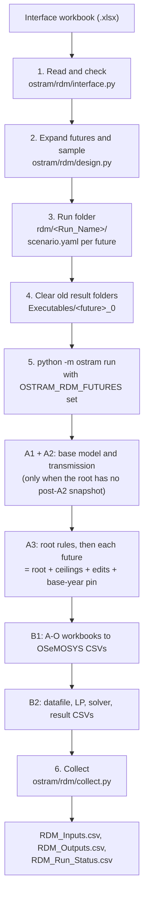

# RDM pipeline in detail

This page follows one `rdm run` from the workbook to the RDM CSVs: what each
step reads, what it decides, what it writes and where. The
[RDM futures](rdm.md) page is the user guide; read it first.

## The whole run at a glance



| Step | Command that runs it | Module |
|---|---|---|
| 1. Read and check | `rdm generate`, `rdm run` | `ostram.rdm.interface.read_interface` |
| 2. Expand futures and sample | `rdm generate`, `rdm run` | `ostram.rdm.design.expand_futures` |
| 3. Write the run folder | `rdm generate`, `rdm run` | `ostram.rdm.design.write_run_folder` |
| 4. Clear old result folders | `rdm run` | `ostram.rdm.collect.clear_future_folders` |
| 5. Build, compile and solve | `rdm run` | `ostram.pipeline.orchestration.main` (the normal `run`) |
| 6. Collect | `rdm run`, `rdm collect` | `ostram.rdm.collect.collect_run` |

`rdm generate` stops after step 3. `rdm run --compile-only` runs every step but
skips the matrix and the solver in B2, so step 6 finds inputs and no results.

## Step 1. Reading and checking the workbook

`read_interface` opens the workbook read-only with cached values
(`data_only=True`). A cell that holds a formula is read as the value Excel last
saved, so save the workbook in Excel after changing a formula.

The sheets `Setup`, `Futures`, `Future_Changes`, `Uncertainty_Table` and
`Outputs` must exist, each with its header row. Blank rows are skipped. Every
check runs before anything is written, and all problems are reported together,
each with its sheet and row:

| Sheet | Check |
|---|---|
| `Setup` | `Run_Name` uses letters, digits, `_` and `-`. `Base_Scenario` is given. `Samples_Per_Future` is a whole number from 0 to 9999. `Random_Seed` is a whole number (blank means 12345). `Run_Central_Future` is Y or N (blank means Y). `Apply_VRE_Ceilings` is Auto, Y or N (blank means Auto). `Model_Last_Year` is after `Model_First_Year` (blank means 2023 and 2050). |
| `Futures` | At least one future; at least one with `Run` = Y. `Future_ID` is a letter followed by letters or digits, and is not repeated. |
| `Future_Changes` | `Future_ID` is on the Futures sheet. `Sheet` is one of the five target sheets. `Parameter` is given; on `Demand_Projection` it is `SpecifiedAnnualDemand`. `Selector_Type` matches the sheet: `Tech`/`Techs`/`Tech_Prefix` on technology sheets, `Fuel`/`Fuels`/`Fuel_Prefix` on `Demand_Projection`. `Selector` is given. `Operation` is one of the four. `Value` is a number, or a technology name for `Copy_From_Tech`. Years are whole numbers inside the model years, `Year_To` not before `Year_From`; `Multiply_Ramp` has both, with `Year_To` after `Year_From`; `Copy_From_Tech` has none and is not used on demand. |
| `Uncertainty_Table` | `X_ID` follows the Future_ID pattern and is not repeated. `Applies_To` is `ALL` (or blank) or Future_IDs on the Futures sheet. The target columns as above. `Method` is `Multiply`, `Multiply_Ramp` or `Set`. `Min` and `Max` are numbers, `Max` not below `Min`. `Linked_To` names another X_ID that is not itself linked. Rows here need `Samples_Per_Future` above 0. |
| `Outputs` | `Kind` is Input or Output for every row with `Export` = Y. |

These checks cover the workbook's own consistency. Whether a technology, fuel
or year exists in the model is checked later, in A3, against the root's actual
workbooks (step 5).

When `generate` or `run` starts, two more checks run against the active setup:
`Base_Scenario` must be one of the setup's roots, and `Apply_VRE_Ceilings` = Y
needs a setup that defines shared VRE ceilings. `Auto` becomes Y for South Asia
and N for the training setup.

## Step 2. Expanding futures and sampling

### Which futures run

For each future with `Run` = Y, in the order of the Futures sheet:

| Situation | Futures created |
|---|---|
| `Samples_Per_Future` = 0 | `F01` |
| No uncertainty applies to the future | `F01` |
| N samples and `Run_Central_Future` = Y | `F01`, `F01_s001` … `F01_sN` |
| N samples and `Run_Central_Future` = N | `F01_s001` … `F01_sN` |

The sample number has at least three digits, more when N needs them
(`F01_s0001` for N = 1000 or more).

### How values are drawn

1. A random generator is seeded with `Random_Seed` (`numpy.random.default_rng`).
2. A Latin Hypercube design with N rows is drawn, with one column per
   uncertainty that has no `Linked_To`, in table order. In each column, the N
   values fall one in each of N equal slices of [0, 1), in random order, at a
   random point inside the slice.
3. Each uncertainty turns its column's position *p* into a value:
   `Min + p × (Max − Min)`, rounded to six decimals. A linked uncertainty uses
   the column of the X_ID it names, so both sit at the same position in their
   own ranges.
4. Sample *s* of every future uses row *s* of the same design: common random
   numbers. `F01_s007` and `F02_s007` share their uncertainty values, so their
   difference comes only from the futures' own changes.

The same workbook and seed always give the same values. Adding, removing or
reordering uncertainty rows changes the design, and so the values of every
sample.

### What a future's edits are

A future's edit list is its own `Future_Changes` rows, top to bottom, followed
by its sampled uncertainties in table order. Each row becomes one or more
scenario edits:

| Workbook row | Scenario edit(s) |
|---|---|
| `Multiply`, no years | `op: multiply`, `factor` |
| `Multiply` with years | `op: multiply`, `factor`, `years: [from … to]` |
| `Set`, no years | `op: set_flat`, `value` (every year column) |
| `Set` with years | `values: {year: value}` for each year from … to |
| `Copy_From_Tech` | `op: copy_from_tech`, `source_tech` |
| `Multiply_Ramp` from *a* to *b*, final factor *f* | one `multiply` per year *y* from *a*+1 to *b* with factor `1 + (f − 1)(y − a)/(b − a)`, then one `multiply` with factor *f* for the years after *b* up to `Model_Last_Year` |

With only `Year_From`, the years run to `Model_Last_Year`; with only `Year_To`,
they start at `Model_First_Year`. Selectors map to `tech`, `techs`,
`tech_prefix`, `fuel`, `fuels` and `fuel_prefix`; `Techs` and `Fuels` are
split at commas. Each edit's `note` holds the row's Note followed by its origin,
for example `[Future_Changes row 4]`.

### How edits combine

Edits apply in list order, each to the result of the ones before it:

- Two `Multiply` edits on the same cells compound: 1.15 then 0.9 gives 1.035.
- A `Set` replaces whatever came before it; a later `Multiply` scales the set
  value.
- Uncertainties come after the future's changes, so they scale or replace the
  future's path, not the root's.
- A `Set` without years writes every year column, base years included. On a
  root with the base-year pin (South Asia's A, B and C roots), the pin
  re-applied at the end of A3 restores the reviewed base-year values of the
  technologies it covers.

## Step 3. The run folder

`write_run_folder` refuses a Future_ID that is already a scenario name in the
setup (a root or a registered decision scenario). It refuses an existing run
folder unless `--overwrite` is given, and then deletes it first. It then writes
`<workspace>/rdm/<Run_Name>/`:

| File | Written from | Content |
|---|---|---|
| `scenarios/<future>/scenario.yaml` | each future | `scenario`, `base_scenario`, a generated `description`, `apply_vre_ceiling_layer` and the `edits` list, in the format of `config/scenarios/<name>/scenario.yaml` |
| `futures.yaml` | all futures | `schema: ostram-futures-v1`, `run_name`, `base_scenario` and the list of future names, in run order |
| `RDM_Experiment_Design.csv` | all futures | `Future_ID`, `Named_Future`, `Future_Name`, `Sample` (0 for a central future), then one column per X_ID, blank where the uncertainty does not apply |
| `rdm_manifest.json` | the Setup sheet | the run settings, the future names and the exported input and output variables |
| `interface.xlsx` | the workbook | an unchanged copy |

The workbook copy, the seed and the `scenario.yaml` files are enough to
reproduce the run: `rdm generate --interface rdm/<Run_Name>/interface.xlsx`
writes the same futures again.

## Step 4. Clearing old result folders

B2 writes each scenario into `Executables/<scenario>_0/` and reuses that folder
when it exists. Before the pipeline starts, `rdm run` deletes the
`Executables/<future>_0/` folder of each future in this run. A future that
fails, or is only compiled, in this run therefore never shows the result of an
earlier run with the same Future_ID. Folders of other scenarios are untouched.
Earlier runs keep their collected results in their own run folders.

## Step 5. Building, compiling and solving

`rdm run` sets `OSTRAM_RDM_FUTURES` to the run's `futures.yaml` and calls the
normal `run` in the same process, as if you had typed:

```text
python -m ostram run --skip-pull --scenarios F00,F00_s001,... [--compile-only] [--env-name ...] [--a-result-seed ...] [--verbose]
```

Each stage runs as a child process, which inherits the variable. The variable is
removed again when the pipeline returns, whether it succeeded or failed.

### How the futures join the scenario registry

Every stage loads the scenario registry (`ostram.pipeline.scenarios.registry.load_registry`).
When `OSTRAM_RDM_FUTURES` is set, `load_futures` reads the futures file and,
for each name in it:

- checks that `scenarios/<name>/scenario.yaml` exists beside the file and
  declares `scenario: <name>`;
- adds a derived scenario with that name, the file's `base_scenario` as its
  parent, and the run folder's `scenarios/` as its config root;
- appends the name to the decision scenarios.

The usual registry checks then run on the whole list: names are safe, no name
is repeated, and every derived scenario's parent is a root. Nothing is read
from or written to `config/` for a future. When the variable is unset, the
registry is exactly the setup's.

### What each stage does for a future

| Stage | What happens | Written to (under the setup's workspace) |
|---|---|---|
| Environment | Checks the conda environment and dependencies. DVC is skipped (`--skip-pull`). | – |
| A1 + A2 | Builds the base model and adds transmission, only when the future's root has no post-A2 snapshot yet (the first run in a workspace). | `preparation/A1_Outputs/_post_a2_snapshot_<root>/` |
| A3, root | Rebuilds the root from its snapshot with the rule scripts named in the Control sheet. | `preparation/A1_Outputs/A1_Outputs_<root>/` |
| A3, future | `scenario_edits.build_scenario`: copies the root's folder to `A1_Outputs_<future>` (replacing an old one), applies the shared VRE ceilings when the future's file says so, applies the edits in order, saves, re-applies the base-year pin where the setup uses it, and writes the edit log. | `preparation/A1_Outputs/A1_Outputs_<future>/` with `apply_patches_CHANGES_<stamp>.json` |
| B1 | Compiles the future's A-O workbooks into OSeMOSYS parameter CSVs. | `compilation/A2_Output_Params/<future>/` |
| B2, datafile | Converts the CSVs with otoole and applies the model-file adjustments of the execution configuration (storage delay, open backstop, reserve-margin fallbacks). | `execution/A2_Outputs_Params_otoole/<future>/`, `execution/Executables/<future>_0/*.txt` |
| B2, solve | Writes the LP with `glpsol --wlp` and solves it with the configured solver (CBC for the training setup, CPLEX for South Asia by default). Skipped with `--compile-only`. | `execution/Executables/<future>_0/*_output.lp`, `*.sol` |
| B2, results | Converts the solution to result CSVs and writes the future's input and output tables. | `execution/Executables/<future>_0/<future>_0_Input.csv` and `Pre_processed_<future>_0_<suffixes>_output.csv` |

Where an edit names a technology, fuel, parameter or year that the future's
root does not have, A3 stops with the message of the
[scenario edits](scenario-edits.md#edits-that-match-nothing), naming the future
and suggesting the closest name. The futures after it are not built.

#### Which workbook an edit changes

- Edits on `Secondary Techs`, `Primary Techs`, `Demand Techs` and
  `VariableCost` change `A-O_Parametrization.xlsx`. They change the first row of
  the technology and parameter on that sheet.
- Edits on `Demand_Projection` change `A-O_Demand.xlsx`, one row per demand
  fuel keyed by its `Fuel/Tech` column. That workbook is opened only when a
  future has a demand edit.
- A changed row whose `Projection.Mode` is blank or `EMPTY` becomes
  `User defined`, so B1 exports it.

#### The edit log

`A1_Outputs_<future>/apply_patches_CHANGES_<stamp>.json` lists every changed
cell with its technology or fuel, parameter, year, old value and new value;
demand cells also carry `"workbook": "A-O_Demand.xlsx"`. When the shared VRE
ceilings apply, their cells are in the list too. It is the place to confirm
that a change did what was intended.

#### What B2 adds beyond the RDM outputs

B2 also writes its usual cross-scenario files,
`execution/OSTRAM_StorageDelay_{Inputs,Outputs,Combined_Inputs_Outputs}.csv`.
They cover every folder in `Executables/`, including scenarios outside the RDM
run. The RDM CSVs of step 6 cover exactly this run's futures.

#### Order and parallel solving

The futures run in the order of the run folder. B2 solves one at a time unless
`parallel: True` is set in the execution configuration, with `max_x_per_iter`
futures per batch (see [configuration](configuration.md)). On the training
model one future compiles in well under a minute; the solve takes the most
time.

#### When the pipeline stops part way

`rdm run` still runs step 6, so the CSVs hold every future that finished, and
`RDM_Run_Status.csv` shows which did not. It then exits with the pipeline's
exit code. The run log, `logs/<run-id>/run.log`, has the full detail.

## Step 6. Collecting the RDM CSVs

`collect_run` finds B2's folder the same way B2 does: from the execution
configuration of the active setup, with the setup's `Executables` folder and
B2's configuration overrides, which decide the result file's suffixes (for
example `_StorageDelayN5_OpenBCK_RMCarefulXLSX_output.csv`). For each future it
looks for:

- the input table `Executables/<future>_0/<future>_0_Input.csv`;
- the result table, the first of B2's candidate names that exists.

It reads only the headers of all files first, so every future is written with
the same columns: `Future_ID`, `Named_Future`, `Sample`, the set columns that
occur (`REGION`, `YEAR`, `TECHNOLOGY`, `FUEL`, `EMISSION`,
`MODE_OF_OPERATION`, `TIMESLICE`, `STORAGE`, `SEASON`, `DAYTYPE`,
`DAILYTIMEBRACKET`), then the variables with `Export` = Y, in the order of the
Outputs sheet. Then, one future at a time, it keeps the rows where at least one
exported variable has a value, adds the three identity columns from
`RDM_Experiment_Design.csv`, and appends them. Memory use is therefore set by
the largest single future, not by the number of futures.

| File | Rows |
|---|---|
| `RDM_Inputs.csv` | the exported input parameters as B2 recorded them in `<future>_0_Input.csv` |
| `RDM_Outputs.csv` | the exported result variables of each solved future |
| `RDM_Run_Status.csv` | one row per future: `solved` (a result table exists), `compiled` (only the input table exists) or `missing` (neither), with both file paths |

The final solver datafile,
`Executables/<future>_0/Pre_processed_<future>_0_StorageDelayN5_OpenBCK_RMCarefulXLSX.txt`,
is the authority on what the solver saw: B2's model-file adjustments act on it
after the input tables are written.

`rdm collect --run <Run_Name>` repeats this step alone, for example after a run
that stopped part way. It takes the exported variables from
`rdm_manifest.json`, not from the workbook. To export different variables
without solving again, edit the Outputs sheet, run `rdm generate --overwrite`
with the same `Run_Name` (it rewrites the run folder but leaves the solved
futures in `Executables/` alone), then `rdm collect`.

## Where everything is

For the training setup, everything is under
`<clone>/workspace/setups/unescap_training/`. For South Asia, the default
setup, the same folders sit directly under `<clone>/workspace/`.

```text
rdm/<Run_Name>/                         the run folder (steps 3 and 6)
  interface.xlsx  futures.yaml  rdm_manifest.json
  RDM_Experiment_Design.csv  RDM_Inputs.csv  RDM_Outputs.csv  RDM_Run_Status.csv
  scenarios/<future>/scenario.yaml
preparation/A1_Outputs/
  _post_a2_snapshot_<root>/             base model after A2 (built once)
  A1_Outputs_<root>/                    the root after its A3 rules
  A1_Outputs_<future>/                  the future's A-O workbooks and edit log
compilation/A2_Output_Params/<future>/  B1 parameter CSVs
execution/A2_Outputs_Params_otoole/<future>/   otoole CSVs
execution/Executables/<future>_0/       datafiles, LP, solution, input and result tables
logs/<run-id>/run.log                   the log of each pipeline run
```

## Troubleshooting

| Message | Meaning and fix |
|---|---|
| `interface workbook not found` | The path is read from the folder you run the command in. Give the full path, or copy the workbook there. |
| `Uncertainty_Table has rows but Samples_Per_Future is 0` | Set `Samples_Per_Future` to 1 or more, or delete the uncertainty rows. |
| `Base_Scenario ... is not a root of this setup` | Use one of the roots listed in the message; check `--setup`. |
| `Apply_VRE_Ceilings is Y, but this setup defines no shared VRE ceilings` | Use Auto or N (the training setup has none). |
| `future name(s) ... are already registered scenarios` | Choose Future_IDs that are not existing scenario names. |
| `run folder exists` | Change `Run_Name`, or add `--overwrite`. |
| `Scenario F02: the edit to ... changed nothing. ... Did you mean ...?` | A selector, parameter or year does not exist in the root. Fix the named row; the edit's note in `scenarios/F02/scenario.yaml` gives the workbook row. |
| A future is `compiled` in `RDM_Run_Status.csv` after a full run | Its solve did not finish. Read `logs/<run-id>/run.log` for the solver message. |
| `rdm` is an unknown command | The environment runs another OSTRAM folder. `python -c "import ostram; print(ostram.__file__)"` shows which; run `pip install -e .` from this clone. |

## Code map

| Module | Main functions |
|---|---|
| `ostram/rdm/interface.py` | `write_template` (the workbook and its dropdowns), `read_interface` (the checks of step 1), the `Interface`, `Future`, `Change` and `Uncertainty` records |
| `ostram/rdm/design.py` | `latin_hypercube`, `sample_values`, `change_to_edits`, `expand_futures`, `write_run_folder` |
| `ostram/rdm/collect.py` | `execution_params`, `future_folder`, `clear_future_folders`, `collect_run` |
| `ostram/rdm/cli.py` | the `template`, `generate`, `run` and `collect` subcommands |
| `ostram/pipeline/scenarios/registry.py` | `load_futures` and the `OSTRAM_RDM_FUTURES` overlay in `load_registry` |
| `ostram/pipeline/scenarios/scenario_edits.py` | `apply_demand_edit` and the demand workbook in `build_scenario` |
| `ostram/pipeline/scenarios/materializer.py` | builds each future from its own config root |
| `tests/regression/test_rdm.py` | solver-free tests of all of the above |

## Design choices

- **A future is a derived scenario.** The edits, the edit log, the error
  messages and B1/B2 are the ones the delivered scenarios already use, so a
  future behaves exactly like a hand-written scenario and can be promoted to one
  by copying its `scenario.yaml` into `config/scenarios/`.
- **The futures live in the workspace, not in `config/`.** `config/` holds
  reviewed, committed scenarios; generated futures would bury them. The
  environment variable registers the futures for one run only.
- **Layered sampling with common random numbers.** Each named future is a
  storyline; the samples test how robust that storyline is to the remaining
  uncertainty, and sharing the draws across futures keeps the comparison fair.
- **Checks before any work.** Reading the whole workbook first means a long run
  never stops on a typing error in row 40.
